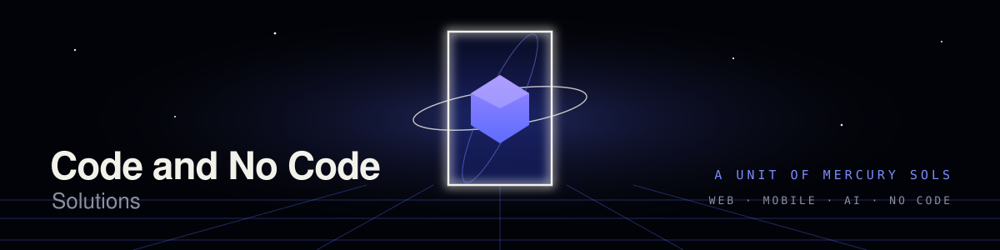
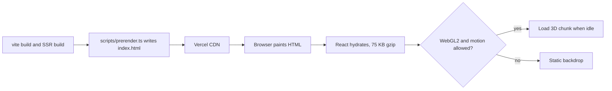

<p align="center">
  
</p>

<p align="center">
  <a href="https://github.com/mfarrukhjaved-381/code-and-no-code-solutions/actions/workflows/ci.yml"></a>
  <a href="LICENSE"></a>
  
  
  
  
  
</p>

<h1 align="center">Code and No Code Solutions</h1>

> A 3D company website that paints its first screen as plain HTML in under half a second on desktop, then flies visitors through a WebGL world to meet the team.

<p align="center">
  <a href="https://code-and-no-code-solutions.vercel.app"><strong>Live site</strong></a>
  ·
  <a href="#-quick-start">Quick start</a>
  ·
  <a href="#%EF%B8%8F-architecture">Architecture</a>
</p>

<p align="center">
  Developed by<br><br>
  <a href="https://github.com/mfarrukhjaved-381"></a><br>
  <strong>Muhammad Farrukh Javed</strong><br>
  for Code and No Code Solutions, a unit of <a href="https://mercurysols.org/">Mercury Sols</a>
</p>

---

## 🎯 Scope, Honestly

This repository is the public website of one software house unit. Out of the box it is a single page, fully static site: a welcome screen, a scroll-driven journey through a 3D world that introduces the four-person team (the lead first, with a crown), then services, delivered projects and direct contact links. All text and images are prerendered into the HTML at build time, and the 3D world is an optional layer loaded afterwards.

What it does **not** do: there is no backend, no CMS, no contact form, no analytics, no multi-language support and no light theme. Content changes are code changes in `src/content/`. The layout is designed desktop first; phones get the same content with a simplified layout and fewer particles, but mobile navigation is still minimal. The 3D world needs WebGL2, and it is built for hardware GPUs: on software-rendered WebGL (for example headless test browsers, some virtual machines and remote desktops) it currently runs at about 8 fps. This is a known issue with a planned fix.

It is a reference for building fast 3D marketing sites, not a reusable template: the brand, photos and copy are specific to this team.

> **Status:** Live in production at [code-and-no-code-solutions.vercel.app](https://code-and-no-code-solutions.vercel.app). Actively developed; Phase 2 (performance, mobile and lead generation) is in progress.

---

## ⚡ Quick Start

**Prerequisites:** Node.js 24 and npm. ImageMagick 7 only if you change images.

<details open>
<summary><strong>Option 1: Clone with Git</strong></summary>

```bash
git clone https://github.com/mfarrukhjaved-381/code-and-no-code-solutions.git
cd code-and-no-code-solutions
npm ci
npm run dev
```

Open http://localhost:5173.

</details>

<details>
<summary><strong>Option 2: Download the source</strong></summary>

1. Download [the main branch as a ZIP](https://github.com/mfarrukhjaved-381/code-and-no-code-solutions/archive/refs/heads/main.zip) and extract it.
2. In the extracted folder run:

```bash
npm ci
npm run dev
```

</details>

<details>
<summary><strong>Option 3: Run the production build locally</strong></summary>

The development server does not prerender. To see exactly what visitors receive:

```bash
npm run build      # type check, client build, server build, prerender
npm run preview    # http://localhost:4173
```

</details>

**Environment variables:** none. The site is fully static and holds no secrets.

---

## 🤔 Why This Exists

- **The Problem:** 3D portfolio sites usually ship their whole WebGL stack up front. A typical build loads around a megabyte of JavaScript and hides it behind an "Initializing experience" loader, so visitors stare at a progress bar before they read a single word.
- **The Fix:** HTML first, 3D second. The build prerenders every word into `index.html`, React hydrates a 75 KB gzip bundle, and three.js arrives in a separate chunk only once the browser is idle and the device can handle it. If WebGL is missing, the visitor prefers reduced motion, or the 3D crashes, the site is still complete.

Measured with Lighthouse 13.6 against the live site on 2026-10-28:

| Metric                             | Desktop       | Mobile        |
| ---------------------------------- | ------------- | ------------- |
| Largest Contentful Paint           | 0.4 s         | 1.3 s         |
| Cumulative Layout Shift            | 0             | 0             |
| Accessibility, Best Practices, SEO | 100, 100, 100 | 100, 100, 100 |
| Performance score                  | 68            | 67            |

The performance score is held down by Total Blocking Time from the 3D render loop on the test browser's software renderer (see Scope). First paint itself is fast.

> [!TIP]
> Check the fallback experience before you ship a change: turn on your operating system's "reduce motion" setting and reload. The 3D world is skipped entirely and every name, photo and project must still be there. The CI end-to-end test enforces the no-JavaScript case.

---

## ✨ Features

**Performance**

- Build-time prerendering: the welcome heading is in the first HTML response and is the LCP element.
- Initial JavaScript budget of 90 KB gzip, enforced in CI by `scripts/check-budget.ts`.
- 3D loaded lazily after idle, only with WebGL2 and motion allowed; two quality tiers by device.
- Self-hosted, preloaded display font with `font-display: optional` (no layout shift).
- WebP images generated at build-ready sizes by `scripts/optimize-images.sh`.

**3D world** (`src/scene/`)

- Grid floor, instanced pillars and light beams, a glowing portal with a faceted crystal, orbit and tick rings, a spiral galaxy and drifting dust, all generated in code (no model or texture downloads).
- One portal per team member down a corridor; the lead's is gold with a 3D crown.
- Camera driven by scroll position and synchronised with the HTML cards, with pointer parallax.

**Interface**

- HUD styling, scroll reveals, hero focus-in, a marquee, a CSS-only scroll progress bar and a trailing cursor ring.
- Ambient sound and interface blips synthesised with the Web Audio API (off by default, no audio files).
- Semantic HTML, skip link, visible focus, reduced-motion support.

**Security and delivery**

- Strict Content Security Policy and security headers in `vercel.json`; no inline scripts.
- Immutable caching for hashed assets and fonts.
- GitHub Actions CI: formatting, lint, unit tests, build, JS budget and Playwright tests.

---

## 🏗️ Architecture



The page and the scene communicate through one contract, `src/shared/scrollStops.ts`: sections marked as stops (hero, each member, services) map the scroll position to a camera keyframe defined in `src/scene/worldLayout.ts`. Neither side imports the other.

| Path            | Contents                                                                  |
| --------------- | ------------------------------------------------------------------------- |
| `src/content/`  | All copy as typed data: brand, team, services, projects                   |
| `src/sections/` | Page sections: Hero, Team, Services, Work, Contact                        |
| `src/ui/`       | Header, section bar, sound toggle, cursor ring, marquee, shared parts     |
| `src/app/`      | App shell, galaxy loader, capability checks, error boundary, sound engine |
| `src/scene/`    | The 3D world (lazy chunk only)                                            |
| `src/shared/`   | The scroll stop contract                                                  |
| `scripts/`      | Prerender, JS budget check, image conversion                              |

---

## 🧰 Tech Stack

| Area           | Technology                                                               |
| -------------- | ------------------------------------------------------------------------ |
| UI             | React 19.3, TypeScript 6.0 (strict), Tailwind CSS 4.3                    |
| 3D             | three.js r186, React Three Fiber 9.8                                     |
| Build          | Vite 8.3, tsx for build scripts                                          |
| Testing        | Vitest 5, Testing Library, Playwright 1.64                               |
| Quality        | ESLint 10 with typescript-eslint strict type-checked rules, Prettier 3.9 |
| Hosting and CI | Vercel, GitHub Actions                                                   |

TypeScript is pinned to 6.0 because typescript-eslint 8.72 supports versions below 6.1 only.

---

## 🛠 Customizing What's Produced

- **Content:** edit the arrays in `src/content/` (`team.ts`, `services.ts`, `projects.ts`, `site.ts`). The first team member is the lead. Adding a member adds their card, navigator dot and 3D portal automatically.
- **Images:** add the source photo to `images/` or `project-pictures/`, map new team photos in `scripts/optimize-images.sh`, run `./scripts/optimize-images.sh`, and commit `public/images/`.
- **The 3D world:** portal positions and every camera keyframe live in `src/scene/worldLayout.ts`; particle counts per device tier are in `src/scene/GalaxyCanvas.tsx`.
- **Design tokens:** colours, fonts, easing and animations are defined once in `src/styles/index.css` under `@theme`.

---

## 🧪 Development and Testing

| Script                                    | Purpose                                                      |
| ----------------------------------------- | ------------------------------------------------------------ |
| `npm run dev`                             | Development server                                           |
| `npm run typecheck`                       | Strict TypeScript check                                      |
| `npm run lint`                            | ESLint                                                       |
| `npm run format` / `npm run format:check` | Prettier                                                     |
| `npm test`                                | Unit tests (Vitest)                                          |
| `npm run build`                           | Type check, client build, server build, prerender            |
| `npm run check:budget`                    | Fails if initial JavaScript exceeds 90 KB gzip (after build) |
| `npm run preview`                         | Serve the production build on port 4173                      |
| `npm run test:e2e`                        | Playwright tests against the preview (after build)           |

```bash
npx playwright install chromium   # first time only
npm run build && npm run test:e2e
```

CI runs all of the above on every pull request and every push to `main`.

---

## 🚀 Deployment

The site deploys to Vercel with no extra settings: `vercel.json` sets the build command, output directory, security headers and cache rules. Import the repository in Vercel; pushes to `main` deploy to production.

---

## 🤝 Contributing

1. Fork the repository and create a branch from `main`.
2. Make your change, keeping content in `src/content/` and the initial bundle within budget.
3. Run `npm run format`, `npm run lint`, `npm test`, `npm run build` and `npm run check:budget`.
4. Open a pull request that explains what changed, why, and how to test it.

Bug reports and suggestions are welcome as [GitHub issues](https://github.com/mfarrukhjaved-381/code-and-no-code-solutions/issues).

## 🔒 Security

Please do not report security issues in public issues. Contact the maintainer privately through [GitHub](https://github.com/mfarrukhjaved-381) instead.

## 📝 License

The source code is released under the [MIT License](LICENSE). Team photographs, project screenshots and the names and branding of Code and No Code Solutions, Mercury Sols and the featured client projects are not covered and remain the property of their owners. Space Grotesk is used under the SIL Open Font License.

## 👤 Author

**Muhammad Farrukh Javed**, software architect at Code and No Code Solutions. GitHub: [@mfarrukhjaved-381](https://github.com/mfarrukhjaved-381)
